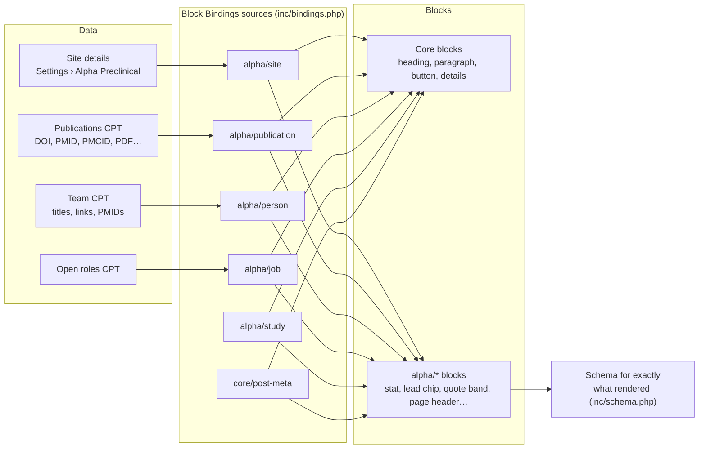

# Alpha Preclinical — WordPress block theme

The production build of the client-approved November 2026 design, as a full-site-editing block theme. **Requires WordPress 6.9+** (custom blocks are bound with the Block Bindings API, which supports custom-block attributes from 6.9) and PHP 7.4+.

## Pages are the approved design, section by section (v1.2)

Every section of the approved static site (the repo root `*.html`) is a custom block in `blocks/sections/<name>/` that outputs **the design's exact markup**. The demo's own CSS and motion script are used unchanged, so pages look and animate exactly like the approved demo.

| Piece | Where | What it does |
| --- | --- | --- |
| 50 page sections + 22 blog-article sections | `blocks/sections/*` | `template.html` is the design's markup with editable values as tokens; `block.json` lists one attribute per value and the field schema (`alphaFields`) for the editor. |
| Renderer | `inc/sections.php` | Fills the template and escapes each value for where it lands (rich text through a small inline-HTML allowlist, links and images through `esc_url`, icons through an SVG filter). |
| Page frame | `alpha/shell` in `templates/*.html` | Outputs the design's frame: skip link, `.ap` wrapper, the page's header section above `<main>`, the footer. |
| Header row | `inc/templates/nav.html` | One shared logo, menu and quote button. Marks the current page the way the design does (`aria-current`, `in-section`). |
| Styles | `assets/css/demo/` | `site.css` and one stylesheet per page design (`skins/*.css`), copied verbatim. Each page loads only its own, in the design's order (page styles, then `site.css`), so pages that styled the same class differently never collide. WordPress global and block-library styles are not loaded on these pages. |
| Motion | `assets/js/demo-site.js` | The design's script: section reveals, count-ups, line drawing, header parallax, wave pause, menus, filters, accordions. The only change: the forms post to WordPress. |
| Live data | `inc/section-data.php` | Publications (list, filters, homepage papers), open roles, team card titles, the blog list and post headers come from records, in the same markup. Team page names and titles use the Block Bindings API (`alpha/person`). |
| Forms | `inc/section-forms.php` | The design's quote and careers forms post to `inc/forms.php` (nonce, honeypot, fill time, rate limit, saved inquiries) and show the design's confirmation panel. |
| Editor | `assets/js/sections-editor.js` | Each section shows its live preview on the canvas; the sidebar lists every text, link and image, with add, remove, duplicate and reorder for repeated items. Fields filled from records say where to edit them. Article text in blog posts is normal paragraphs, headings and lists. |

**Regenerating from the design.** After a design change in the static pages, run `python3 tools/export_wp.py` and then `python3 tools/build_sections.py`. The second step rebuilds the section blocks, skins, page and post seeds, the publications seed and the page templates. It needs Node with `@wordpress/blocks`, `@wordpress/block-library` and `global-jsdom` (set `ALPHA_NODE_MODULES` to their `node_modules`) to write blog article text as core blocks. Then re-import (Tools › Alpha Preclinical setup, with "Leave existing items untouched" off).

**Checked against the design** (local WordPress 7.1, Chromium):

- Every page and blog post renders the same markup as the demo, section by section. The only differences are the forms' hidden security fields and real post dates.
- Every element has the same position, size and computed type at 1440 px and 390 px.
- The motion script does the same thing on both: the same reveal targets, count-ups, line drawing and parallax values.
- axe finds no WCAG 2.2 AA violations.

## How the data and bindings fit together



- **Every bespoke component is a dynamic `alpha/*` block** (`blocks/*/block.json` + `render.php`), rendered on the server so markup, accessibility and schema live in one place.
- **Their content attributes are bindable.** `inc/bindings.php` registers them through `block_bindings_supported_attributes` (WordPress 6.9), so a stat can count publications live, a "Led by" chip can take its people from a source, a page header can take its lead from a team member's job title.
- **Data lives in post types and settings**, never in markup: publications, team members and open roles are custom post types with registered meta; contact facts, quote routing and the accessibility response time are in **Settings › Alpha Preclinical**.
- **Core blocks stay core** (headings, paragraphs, buttons, details): they're bound to the same sources, so editors keep the normal editing tools. A bound block whose value is empty is removed (a paper with no PMCID shows no "Free full text" button).
- **No build step.** `assets/js/editor.js` uses the `wp.*` globals: it gives each alpha block a live server preview with sidebar controls generated from its attributes, registers the binding sources in the editor, and adds meta panels.

### Component blocks

These predate the section blocks. They still work and are used by the secondary templates (archive and search) and in patterns; the designed pages use the section blocks above.

| Block | What it is | Bindable attributes |
| --- | --- | --- |
| `alpha/strata-band` | Drifting wave bands with a Pause button (hero, page, thin) | — |
| `alpha/hero-alpha` | The logo's alpha filled by rising strata (homepage) | — |
| `alpha/page-header` | Breadcrumbs, H1, lead, strata band | `heading`, `lead` |
| `alpha/contour` | One wave line divider that draws in | — |
| `alpha/lead-chip` | "Led by" with photos, linked to profiles | `members`, `label` |
| `alpha/stat` | Count-up number with an accessible label | `value`, `suffix`, `label` |
| `alpha/faq` + `alpha/faq-item` | Accordion that prints FAQPage schema | `question`, `answer` |
| `alpha/cta-band` | Closing quote band | `heading`, `text`, `buttonText`, `buttonUrl`, … |
| `alpha/filter-chips` | Filters the next Query Loop by term, announces results | — |
| `alpha/quote-form` | Quote form or job application (nonce, honeypot, rate limit, routing) | — |
| `alpha/contact-card` | Email, phone, address | `email`, `address`, `phone` |
| `alpha/person-card` | Team portrait card with hover photo | `slug` |
| `alpha/person-links` | LinkedIn, ORCID, Scholar, PubMed (exact PMIDs) | `linkedin`, `orcid`, `scholar`, `pubmed` |
| `alpha/meta-list` | List from a multi-line field (education, requirements…) | — |
| `alpha/breadcrumbs` | Breadcrumbs + BreadcrumbList schema | `current` |

### Binding sources

| Source | Keys | Example |
| --- | --- | --- |
| `alpha/site` | `email`, `email_link`, `phone_link`, `address`, `publication_count`, `team_count`, `quote_url`, `copyright`, `a11y_promise`, … | Footer address; "16 papers" stat |
| `alpha/publication` | `title_link`, `authors` (Alpha authors bold), `citation`, `ids`, `pdf_url`, `pubmed_url`, `pmc_url`, `doi_url` | Publication cards in a Query Loop |
| `alpha/person` | `name`, `name_link`, `job_title`, `short_title`, `bio`, `linkedin`, `pubmed_url`, … (`slug` or `field` arg) | Blog byline and author box |
| `alpha/job` | `title`, `summary`, `team`, `location`, `apply_url` | Role rows (bound `core/details` summary) |
| `alpha/study` | `url`, `label` with `study` arg | "Plan your PK/PD study" → `/contact/?study=PK%2FPD#form` |

## Files

```text
alpha-preclinical/
├── style.css, theme.json, functions.php, screenshot.png
├── styles/sections/   section styles: abyss, mist, paper, footer (Group block styles)
├── styles/blocks/     button styles: light, ghost-dark, arrow; list "rows"; table "specs"
├── blocks/            17 alpha/* blocks (block.json + render.php), incl. the staging-only content review
├── inc/               post types, bindings, blocks, forms, schema, redirects, settings, staging, review, seed importer
├── templates/         front-page, page, page-wide, page-legal, home (blog), single, single-team_member,
│                      single-job, single-publication, archive, search, index, 404
├── parts/             header, footer, page-header, post-header
├── patterns/          header, footer + 11 section patterns for the inserter
├── assets/            theme.css, theme.js (motion, filters, forms), editor.js, fonts (self-hosted woff2), img
└── seed/              the approved content, exported from the static site by tools/export_wp.py
```

## Put it on staging (Cloudways)

1. **Make the zip:** `tools/package_theme.sh` → `dist/alpha-preclinical-<version>.zip`. GitHub Actions also builds it on every push (Actions › Theme › artifact).
2. **Create the app:** a WordPress application on your Cloudways server (WordPress 6.9+, PHP 8.1+). Turn on SSL for the staging domain.
3. **Install the theme:** Appearance › Themes › Add New › Upload Theme, then activate.
4. **Import the content:** SSH into the app (Cloudways › Master credentials), `cd public_html`, then:
   ```bash
   wp alpha seed                 # pages, team, papers, roles, blog drafts; turns staging mode on
   wp alpha migrate-pdfs         # copy the 16 PDFs off Wix while it's still up
   ```
   No SSH? Use **Tools › Alpha Preclinical setup** instead.
5. **Lock it down:** in **Settings › Alpha Preclinical**, tick **Private staging** so only logged-in people can see the site. Staging mode already hides it from search engines and shows a banner.
6. **Mail:** turn on Cloudways' SMTP add-on (or an SMTP plugin) so form and review emails arrive. Set **Email review answers to** if they should go somewhere other than the admin email.
7. **Invite Alpha:** give each person a **Client reviewer** account:
   ```bash
   wp alpha add-reviewer chris@alphapreclinical.com --name="Chris"
   ```
   (or Users › Add New with the role "Client reviewer"). They get an email to set a password and land on **/content-review/** when they log in.
8. **SEO plugin:** install Rank Math or Yoast. The import pre-fills each post's SEO title, description and focus keyword.

### The Content review page

`/content-review/` (the `alpha/content-review` block, staging only) lists every open question in six sections: Team, Expertise and publications, Contact and forms, Careers, Blog posts, and Legal, brand and files. Reviewers answer what they can and save each section. Progress is saved per question, with who and when.

- **Answers marked "Updates the site" change staging as soon as they're saved:** job titles, ORCID, Scholar and LinkedIn links, the phone number, quote inbox and per-study routing, the careers inbox, the accessibility response time, which roles are listed, whether the three LNP papers show, and Joan's Becker line.
- **Everything else is recorded for you to act on:** bio and blog approvals with notes, who leads fibrosis, tumor models and IVIS, model-list changes, the editorial policy, legal status, card details, and uploaded photos, logos and documents (saved to the media library).
- **Review the answers** in **Tools › Content review** (table plus CSV export). Each save also emails a summary.
- **Security:** each section save checks a nonce and the `alpha_review` capability. Uploads accept images, PDF, AI, EPS, Word and zip only (no SVG). Fields the form didn't send are left as they were.

### At launch

Untick **Staging mode** (this closes the review page and lets search engines in). Delete or demote the reviewer accounts, point the domain at the app, check redirects, and submit the sitemap.

## Tested

On WordPress 6.9 (SQLite) with the imported content:

- Staging: reviewer login lands on the review page and is kept out of the dashboard; saves update phone, routing, titles, roles and papers on the site; untouched fields are left alone; bad nonce → 403, logged out → 400, reviewer can't export the CSV; a PHP file renamed as an image is rejected; private staging sends visitors to the login; with staging off the review page closes. axe: no violations on the review page.
- All 20 URLs render with no PHP notices; `/experetise` and old `/_files/ugd/…` PDF links redirect (301).
- All 1,259 blocks in the seed pages, posts, team bios, templates, parts and patterns pass core block validation (`@wordpress/blocks` + `@wordpress/block-library`), so nothing opens as "invalid block" in the editor.
- Bindings resolve on the front end: 16 publication cards with citations and IDs, 5 team cards, live counts; empty bound buttons are removed.
- Every alpha block renders through the editor's block-renderer REST endpoint.
- Quote form: valid submission saved and routed; bad nonce rejected; honeypot silently dropped; off-site `return_to` refused; résumé upload accepts PDF/Word only and is deleted after sending.
- axe-core (WCAG 2.1 A/AA, contrast excluded in jsdom): no violations on 11 key pages.

Still to do on staging: a real-browser pass (contrast, motion, mobile menu), VoiceOver and NVDA, and mail delivery.

## Security notes

- Every form handler verifies a nonce before reading input. The public quote form adds a honeypot, a minimum fill time and a per-visitor rate limit. Admin actions (import, PDF migration) check `manage_options` and `check_admin_referer`.
- `$_GET` is read only to preselect form options and show a status message, never to change state.
- Uploads are type-checked with `wp_check_filetype_and_ext`, capped at 5 MB, emailed, then deleted.
- Content types are registered in the theme because this is a single-site, agency-maintained theme. If Alpha might ever switch themes, move `inc/post-types.php` into a small site plugin unchanged.
